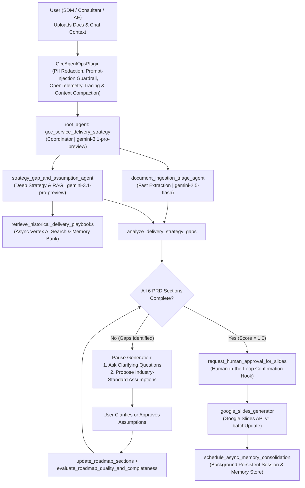

# GCC Service Delivery Strategy Agent

An enterprise-grade AI agent built with the **Google Agent Development Kit (ADK)** for **Gemini Enterprise**. It streamlines, standardizes, and accelerates the creation of structured **Google Cloud Consulting (GCC) Service Delivery Strategy** roadmaps from user-uploaded customer documents (PDFs, Google Docs, Spreadsheets) and interactive chat inputs, outputting a formatted **Google Slides presentation**.

---

## 1. Problem & Solution Statement

- **Problem**: Drafting customer-ready Service Delivery Strategy roadmaps across Vision, Phased Strategy, Commercials, Delivery Approach, RACI, and Operating Models is manual, time-intensive, and inconsistent across engagements.
- **Solution**: The **GCC Service Delivery Strategy** multi-agent system ingests customer discovery documents and chat context, automatically detects data gaps across the 6 mandatory PRD sections, asks targeted clarifying questions while proposing benchmarked GCC/PSO assumptions, enforces human-in-the-loop approval, and programmatically generates a branded Google Slides presentation via the Google Slides API (`v1`).

---

## 2. Multi-Agent Architecture & Workflow



### Required Output Sections (Google Slides)
Every generated presentation includes a branded Cover Slide followed by dedicated slides for all six required PRD sections:
1. **Vision**: Customer North Star objectives, business outcomes, and executive sponsorship.
2. **Services Delivery Strategy**: Phased transformation roadmap, workstreams, and value realization timeline.
3. **Commercials**: Engagement structure, pricing/contract model (Fixed Price, T&M, Milestone), investment profile, and terms.
4. **Delivery Approach**: Execution methodology, Agile/IaC governance, quality assurance, and risk mitigation.
5. **Roles & Responsibilities**: RACI matrix across Customer, Google Cloud Consulting (PSO), and Partner teams.
6. **Operating Model (PSO only, Partner, or both)**: Explicit operating model selection (`PSO only`, `Partner`, or `PSO & Partner (Hybrid)`), governance cadences, and escalation paths.

---

## 3. AI in 5 Days Assessment Agent — AgentOps Rubric Traceability (95 / 95 Points)

| Category | Criteria (5 pts each) | Code Evidence in Repository |
| :--- | :--- | :--- |
| **1. Tool & Interface Design** | **Comprehensive Tool Docstrings** | Detailed Google-style docstrings (`Args`, `Returns`) on every tool in `gcc_service_delivery_strategy/tools/gap_analyzer.py`, `slides_generator.py`, and `memory.py`. |
| | **Descriptive Naming** | Specific, action-oriented tool names: `analyze_delivery_strategy_gaps`, `record_verified_roadmap_sections`, `evaluate_roadmap_quality_and_completeness`, `request_human_approval_for_slides`, `retrieve_historical_delivery_playbooks`, and `google_slides_generator`. |
| | **Explicit JSON Schemas** | Strict Pydantic v2 schemas (`ConfigDict(extra="forbid")`) in `gcc_service_delivery_strategy/models.py`: `GapAnalysisInput`, `GapAnalysisOutput`, `RoadmapUpdateInput`, `SlidesGeneratorInput`, `SlidesGeneratorOutput`, and `ServiceDeliveryStrategyRoadmap`. |
| | **Guided Error Handling** | Every tool catches `ValidationError` and incomplete-section states and returns structured `recovery_instructions` guiding the LLM on how to recover without crashing. |
| **2. Context & Memory** | **Robust System Instructions** | Explicit `<CONSTITUTION>` in `gcc_service_delivery_strategy/prompts.py` defining Persona, Domain Knowledge, Hard Constraints, and Security Rules. |
| | **History Compaction** | ADK `EventsCompactionConfig` + `ContextCacheConfig` on `App` in `agent.py` and `compact_conversation_contents` sliding-window/token-budget truncation in `memory.py`. |
| | **Persistent Session State** | `VertexAiSessionService`, `DatabaseSessionService`, `VertexAiMemoryBankService`, `PersistentRoadmapStore` (SQLite), and `discoveryengine_v1.SearchServiceAsyncClient` (Vertex AI Search) in `memory.py`. |
| | **Async Memory Operations** | Non-blocking `schedule_async_memory_consolidation` (`asyncio.create_task` + `asyncio.to_thread`) and `async def retrieve_historical_delivery_playbooks` in `memory.py`. |
| **3. Orchestration & Logic** | **Multi-Agent Patterns** | Coordinator (`root_agent`) delegating to `document_ingestion_triage_agent` and `strategy_gap_and_assumption_agent` in `gcc_service_delivery_strategy/agent.py`. |
| | **Strategic Model Routing** | `StrategicModelRouter` in `plugins.py` and sub-agent configuration routing fast extraction/triage to `gemini-2.5-flash` and complex strategy formulation to `gemini-3.1-pro-preview`. |
| | **Guardrails & Policy Plugins** | `GccAgentOpsPlugin(BasePlugin)` in `plugins.py` enforcing prompt-injection blocking, PII scrubbing, and `evaluate_roadmap_completeness` self-evaluation. |
| | **Human-in-the-Loop Hooks** | `request_human_approval_for_slides` and `GccAgentOpsPlugin.before_tool_callback` gating external Google Slides creation on `human_approval_granted`. |
| **4. Observability & Tracing** | **Structured JSON Logging** | `StructuredJsonFormatter` and `get_structured_logger` in `observability.py` emitting single-line JSON logs with trace/span IDs (zero bare `print` calls in agent modules). |
| | **Intent vs. Outcome Capture** | `log_agent_intent` (`phase="INTENT"`) and `log_agent_outcome` (`phase="OUTCOME"`, `intent_matched_outcome`, `latency_ms`) recorded across all agents and tools in `observability.py`. |
| | **Distributed Tracing** | OpenTelemetry `TracerProvider`, `CloudTraceSpanExporter`, and `@traced_span` context manager linking parent-child spans in `observability.py`. |
| | **PII Redaction** | `PiiScrubber` in `observability.py` combining Google Cloud DLP API (`google.cloud.dlp_v2`) de-identification and regex redaction for emails, phones, SSNs, credit cards, and OAuth tokens. |
| **5. Infrastructure & CI/CD** | **Automated Evaluation Suites** | Golden dataset `evals/golden_dataset.json`, automated harness `evals/run_evaluation.py`, unit tests `tests/test_agent_and_tools.py`, and CI workflow `ci/ci_eval.yml`. |
| | **Infrastructure as Code** | Terraform configuration in `terraform/main.tf`, `terraform/variables.tf`, and `terraform/outputs.tf` plus ADK CLI usage documented below. |
| | **Secure Secret Management** | `SecretManagerClient` (`google.cloud.secretmanager`) in `gcc_service_delivery_strategy/secrets.py` fetching OAuth credentials with zero hardcoded secrets. |

---

## 4. Repository Structure (Root GitHub Project)

```text
gcc-service-delivery-strategy-agent/
├── ci/
│   └── ci_eval.yml                           # Automated Pytest & Golden Evaluation CI pipeline
├── README.md
├── pyproject.toml
├── requirements.txt
├── .env.example
├── .gitignore
├── deploy.py                                 # Vertex AI Agent Engine (AdkApp) deployment
├── gcc_service_delivery_strategy/
│   ├── __init__.py                           # Exports `agent` for ADK CLI discovery
│   ├── agent.py                              # Multi-agent hierarchy & `App` configuration
│   ├── models.py                             # Strict Pydantic v2 input/output JSON schemas
│   ├── prompts.py                            # System `<CONSTITUTION>` & sub-agent instructions
│   ├── memory.py                             # History compaction, persistent DB, Vertex Search & async memory
│   ├── plugins.py                            # `GccAgentOpsPlugin`, model router, guardrails & HITL hooks
│   ├── observability.py                      # Structured JSON logging, Intent/Outcome, OTel & Cloud DLP PII scrubber
│   ├── secrets.py                            # Google Cloud Secret Manager integration
│   └── tools/
│       ├── __init__.py
│       ├── gap_analyzer.py                   # Gap analysis, assumption approval, self-eval & HITL tools
│       └── slides_generator.py               # `google_slides_generator` ADK tool (Slides API v1)
├── evals/
│   ├── golden_dataset.json                   # Golden evaluation dataset
│   └── run_evaluation.py                     # Automated evaluation runner
├── terraform/
│   ├── main.tf                               # GCP APIs, Service Account, IAM, GCS & Secret Manager IaC
│   ├── variables.tf
│   └── outputs.tf
└── tests/
    ├── __init__.py
    └── test_agent_and_tools.py               # Unit & AgentOps rubric verification tests
```

---

## 5. Quickstart, ADK CLI & Terraform Deployment

### 1. Install Dependencies
```bash
python3 -m venv .venv
source .venv/bin/activate
pip install -r requirements.txt
```

### 2. Provision Cloud Infrastructure with Terraform (IaC)
```bash
cd terraform
terraform init
terraform apply -var="project_id=your-gcp-project-id" -var="region=us-central1"
cd ..
```

### 3. Run & Debug Locally with the ADK CLI
```bash
# Interactive terminal session
adk run gcc_service_delivery_strategy

# Launch the ADK Web UI (http://localhost:8000)
adk web .

# Start the ADK HTTP API Server
adk api_server .

# Run ADK Evaluation against the golden evaluation set
adk eval gcc_service_delivery_strategy evals/golden_dataset.json
```

### 4. Run Unit Tests & Automated Golden Evaluation Suite
```bash
pytest -v
python3 evals/run_evaluation.py
```

### 5. Deploy to Vertex AI Agent Engine & Gemini Enterprise
```bash
# Option A: Deploy via ADK CLI
adk deploy agent_engine \
  --project="your-gcp-project-id" \
  --region="us-central1" \
  --staging_bucket="gs://your-staging-bucket" \
  gcc_service_delivery_strategy

# Option B: Deploy via the custom AdkApp streaming deployment script
python3 deploy.py \
  --project="your-gcp-project-id" \
  --location="us-central1" \
  --staging-bucket="gs://your-staging-bucket" \
  --display-name="GCC Service Delivery Strategy"
```
